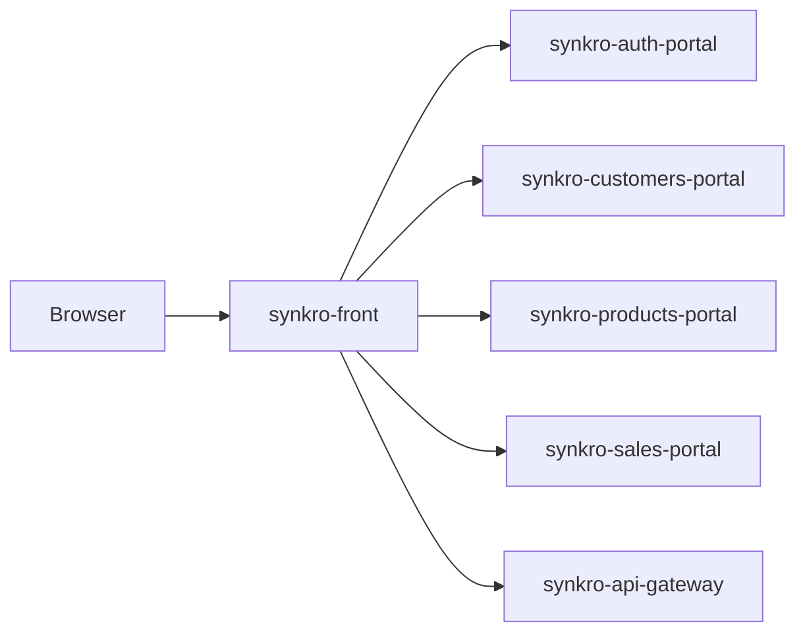

# synkro-front

> Web Host that owns the session, shared HTTP client, role-aware navigation and loading of the four domain portals.

Part of the **SynkroTech SAS Sales Management System**. Architecture, decisions and
contracts live in [synkro-docs](https://github.com/code-corhuila/synkro-docs).

**Quick start:** from this root with Node 22, run `npm ci` and `npm run dev`; configure the gateway and remote entries first. See [Getting started](#getting-started).

## What it does

- Owns human authentication, session renewal/logout and session recovery.
- Provides the single HTTP client consumed by every portal.
- Applies the shared navigation/access matrix and mounts remotes on demand.
- Hosts dashboard content and isolates a failed remote from the remaining application.
- Shares design tokens and Spanish interface copy across the portal boundary.

## Where it fits



React remotes use Module Federation; the Angular Customers portal receives ShellContract through a custom-element property. HTTP and session ownership stay in the Host in both cases.

## Tech stack

| Component | Choice |
|---|---|
| Language / framework | TypeScript; React 19; React Router |
| Build | Vite and Module Federation |
| Verification | Vitest, oxlint and compiled production checks |
| Runtime | NGINX host; root composition publishes 5173 |

## Dependencies

| Depends on | Purpose | Configuration |
|---|---|---|
| Four domain portals | Domain screens and dashboard contribution | VITE_*_PORTAL_ENTRY |
| synkro-api-gateway | Single backend origin | VITE_API_BASE_URL |
| synkro-auth-api | Real human session lifecycle | Through the gateway |

## Getting started

Use **PowerShell or Bash** from this root with Node 22. Prepare `.env.local` from `.env.example` for the selected gateway and remote entries.

```text
npm ci
npm run dev
```

Build and serve the required remotes separately for local federation, or use the full root composition. Vite build-time inputs require rebuilding when changed. Development token sign-in is a deliberate local option; production checks reject it in deployed bundles.

For the complete platform, start from [synkro-infra-postgres](https://github.com/code-corhuila/synkro-infra-postgres).

## Configuration

The committed [.env.example](.env.example) is the configuration inventory.
Its values are examples; required inputs and defaults follow its comments and the
owning implementation. Keep real secrets in protected local files.

| Variable | Purpose |
|---|---|
| `VITE_API_BASE_URL` | Connection address, origin or build-time entry point |
| `VITE_DEV_SIGN_IN` | Vite dev sign in |
| `VITE_PRODUCTS_PORTAL_ENTRY` | Connection address, origin or build-time entry point |
| `VITE_SALES_PORTAL_ENTRY` | Connection address, origin or build-time entry point |
| `VITE_AUTH_PORTAL_ENTRY` | Connection address, origin or build-time entry point |
| `VITE_CUSTOMERS_PORTAL_ENTRY` | Connection address, origin or build-time entry point |

VITE_* values are compiled into browser assets and must not contain secrets. The default container uses a same-origin backend proxy. Host/remote entry URLs are browser addresses, not Docker DNS names.

## Interface

| Boundary / route | Responsibility |
|---|---|
| shell/apiClient | Shared HTTP transport, headers, correlation and idempotency |
| shell/session; shell/authentication | Identity/session lifecycle and login |
| /login | Public Auth login screen |
| /dashboard | Authenticated role-scoped dashboard |
| /customers | ADMIN / SALESPERSON |
| /products; /stock-alerts | ADMIN / INVENTORY |
| /stock | SALESPERSON stock lookup |
| /sales | ADMIN / SALESPERSON |
| /users; /service-tokens | ADMIN |

The single source of route authorization is `src/layout/navigation.ts`. Unknown routes/roles are denied rather than inferred from a portal's UI.

## Project structure

```text
src/core/       HTTP, authentication and session
src/layout/     navigation, role matrix and common layout
src/            routes, remote boundaries and UI composition
deploy/         NGINX, Dockerfile and Compose host
scripts/        production-output verification
docs/           integration, session and design evidence
```

## Testing

```text
npm test
npm run coverage
npm run lint
npm run build
npm run check:production-build
```

Coverage is 70% global and 85% for the configured client/session/authentication modules. Unit tests and compiled-output checks are distinct from real multi-service browser acceptance; retain their original execution scope.

## Branching and contributing

Use a `feat/`, `fix/` or `chore/` child branch and a PR into `develop`.
Permanent branches are `develop`, `qa` and `main`; none accepts direct commits.
Promote through a `qa-<description>` or release child with `git cherry-pick -x`.
`main` requires approval from `ariel5253`. Use English Conventional Commits.
See [Git conventions](https://github.com/code-corhuila/synkro-docs/blob/main/00-governance/git-conventions.md).

## Further documentation

- [Local development](docs/local-development.md).
- [Testing](docs/testing.md).
- [Shared shell contract](docs/shared-shell-contract.md).
- [Design tokens and access](docs/design-tokens-and-access.md).
- [Authentication operations readme](docs/authentication-operations-readme.md).
- [Deployment](docs/deployment.md).
- [Domain rules](https://github.com/code-corhuila/synkro-docs/blob/main/02-domain/entities-and-rules.md), [contracts](https://github.com/code-corhuila/synkro-docs/tree/main/07-api/contracts/openapi) and [testing strategy](https://github.com/code-corhuila/synkro-docs/blob/main/11-quality/testing-strategy.md).

<!-- Preserve previously published README section links. -->
<a id="branching"></a>
<a id="running-locally"></a>
<a id="running-the-tests"></a>
<a id="modules-exposed-to-remotes"></a>
<a id="one-react-in-the-page"></a>
<a id="request-options-of-shellapiclient"></a>
<a id="checking-it-end-to-end"></a>
<a id="design-tokens"></a>
<a id="who-can-open-what"></a>
<a id="interface-language"></a>
<a id="the-development-sign-in"></a>
<a id="deployment"></a>
<a id="continuous-integration"></a>
<a id="root-composition-delivery"></a>
<a id="root-sales-integration"></a>
<a id="production-authentication-hu-fe-08"></a>
